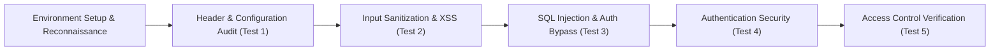

# Web Security Review - Methodology

## 1. Overview
The defensive web security assessment followed an industry-standard framework combining elements of the **OWASP Web Security Testing Guide (WSTG)** and the **NIST SP 800-115** technical assessment guidelines. Testing was conducted in a grey-box format within an authorized local training environment (**OWASP Juice Shop**).

---

## 2. Test Execution Details

### Test 1: Security Misconfiguration – HTTP Security Headers
- **Approach:** Inspected HTTP response headers using browser developer tools (Network tab) on `http://localhost:3000`.
- **Target:** Verified presence and adequacy of headers: `X-Content-Type-Options`, `X-Frame-Options`, `Content-Security-Policy`, `Strict-Transport-Security`, and CORS policies.

### Test 2: Cross-Site Scripting (XSS)
- **Approach:** Evaluated how user-supplied search queries are handled by entering standard test payloads (``).
- **Target:** Examined URL encoding, search response rendering, and DOM script execution.

### Test 3: SQL Injection – Authentication Bypass
- **Approach:** Injected SQL control syntax (`' OR 1=1--`) into the login email field to test backend query construction.
- **Target:** Verified whether the application concatenated raw input, allowing authentication as an administrator without valid credentials.

### Test 4: Authentication Security Testing
- **Approach:** Registered a test user (`abc@gmail.com`) and submitted incorrect credentials to observe application response behavior.
- **Target:** Verified whether error messages leak username existence or provide secure, generic responses.

### Test 5: Access Control Testing
- **Approach:** Assessed the `/rest/user/whoami` endpoint across two states:
  1. Authenticated state (logged in with test account).
  2. Unauthenticated state (logged out).
- **Target:** Verified whether the endpoint protects sensitive user identity details when accessed without a valid session.

---

## 3. Testing Environment & Tools
- **Target Application:** OWASP Juice Shop v20.3.0
- **Environment:** Localhost isolated instance (`http://localhost:3000` / `127.0.0.1`)
- **Inspection Tools:** Chromium / Chrome DevTools (Network, Console, Application Tab)
- **Reporting Platform:** Markdown & Visual Screenshot Repositories
